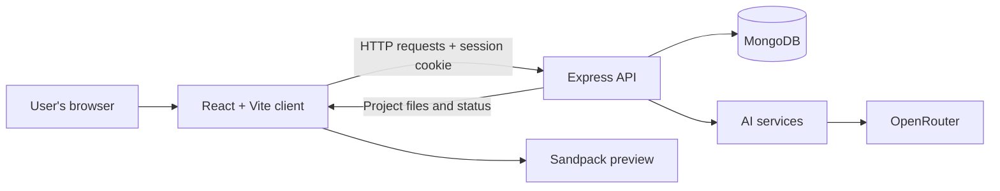
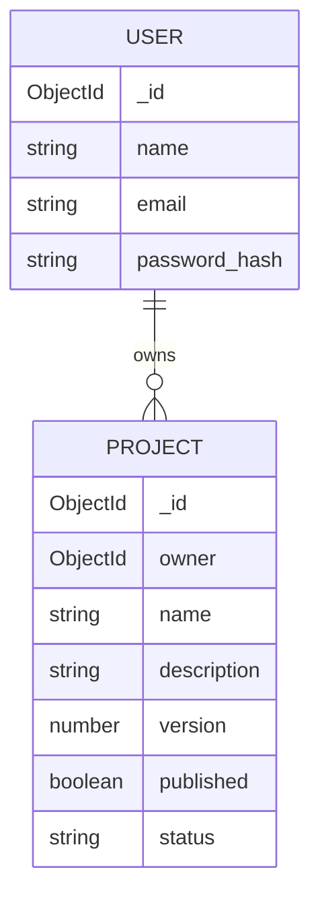

# WeaveAI

> Turn a website idea into an editable React project with AI-assisted generation and live preview.


## Overview

WeaveAI is a web app for creating React websites from natural-language prompts. It asks an AI model to plan and generate project files, then provides a browser-based workspace to preview and edit the result. Users can request follow-up changes through chat, save code edits, export the project as a ZIP, and make a project viewable through a public link served by the app.

WeaveAI is intended for people who want to prototype or build websites through prompts, as well as developers who want to inspect and edit generated code.

## Contents

- [Features](#features)
- [Technology stack](#technology-stack)
- [Architecture](#architecture)
- [Repository structure](#repository-structure)
- [Setup](#setup)
- [Environment variables](#environment-variables)
- [Using WeaveAI](#using-weaveai)
- [API](#api)
- [Data model](#data-model)
- [Contributing](#contributing)
- [License](#license)

## Features

### Create and edit projects

- **Prompt-based generation:** Submit a description to create a project. The server plans a file structure and generates files progressively.
- **Generation progress:** View planned files, completed files, the file being generated, and generation errors.
- **Chat-based revisions:** Ask the AI to create, update, or delete project files.
- **In-browser code editing:** Inspect and edit generated files in the project workspace. Edits are saved to the server after a short debounce.
- **Live preview:** Preview generated React code in the browser, with an option to show the code editor alongside the preview.
- **Project management:** List, open, and delete projects associated with your account.

### Export and sharing

- **ZIP export:** Download project source files and a generated Vite package configuration as a ZIP archive.
- **Public project links:** Mark a project as published and view it at `/publish/:id` on the same WeaveAI app instance. This makes the project viewable through the app; it does not deploy the generated project to a separate hosting provider.

### Accounts

- Register and sign in with an email and password.
- Authentication uses a JWT stored in an HTTP-only cookie.

## Technology stack

| Area | Technologies |
|---|---|
| Frontend | React 19, Vite, React Router, Tailwind CSS 4 |
| Editor and preview | CodeSandbox Sandpack React |
| Backend | Node.js, Express 5 |
| Database | MongoDB with Mongoose |
| Authentication | JSON Web Tokens, HTTP-only cookies, bcrypt |
| AI | Vercel AI SDK with an OpenAI-compatible provider configured to use OpenRouter |
| Other frontend libraries | Axios, `react-hot-toast`, `lucide-react`, Luxon, JSZip, FileSaver |
| Development tools | npm, Oxlint, Nodemon |

## Architecture

The client is a Vite React application. It calls the Express API using Axios with cookies enabled. The API connects to MongoDB through Mongoose. Project generation and revisions are handled by server-side AI services that call OpenRouter. The client uses Sandpack to run generated React code in a browser preview.



Project generation is asynchronous: the API creates a project record and starts generation in the background. The client periodically reloads the project while it is pending or generating.

## Repository structure

```text
WeaveAI/
├── client/
│   ├── public/                  # Logo and favicon
│   ├── src/
│   │   ├── api/                 # Axios API client
│   │   ├── assets/              # Frontend assets and prompt suggestions
│   │   ├── components/          # Builder, chat, file tree, preview, and UI
│   │   ├── context/             # Authentication and project state/actions
│   │   ├── pages/               # Home, auth, builder, preview, and publish pages
│   │   ├── utils/               # ZIP export and Sandpack dependency detection
│   │   ├── App.jsx
│   │   ├── index.css
│   │   └── main.jsx
│   ├── index.html
│   ├── README.md                # Existing Vite template documentation
│   ├── package.json
│   ├── package-lock.json
│   └── vite.config.js
├── server/
│   ├── config/                  # MongoDB connection
│   ├── controllers/             # Auth, project, and chat request handlers
│   ├── middleware/              # Authentication middleware
│   ├── models/                  # Mongoose User and Project models
│   ├── routes/                  # Auth and project API routes
│   ├── services/                # AI generation, schemas, prompts, validation, diffs
│   ├── package.json
│   ├── package-lock.json
│   └── server.js
└── LICENSE
```

The repository has separate npm projects for the client and server; there is no root `package.json`.

## Setup

### Prerequisites

- Node.js and npm. The repository does not pin a Node.js version.
- A MongoDB instance and its connection URI.
- An OpenRouter API key for AI generation and revisions.

### Clone the repository

```bash
git clone https://github.com/Pruthvi5559/WeaveAI.git
cd WeaveAI
```

### Install dependencies

Install the client and server dependencies separately:

```bash
cd client
npm install
cd ../server
npm install
```

### Configure environment variables

Create `server/.env` and `client/.env.local` as described in [Environment variables](#environment-variables). These files are not included in the repository.

For local development, set the client API URL to `http://localhost:3000` and allow the Vite origin `http://localhost:5173` in the server's `ORIGINS` setting.

### Start the application

Run the backend and frontend in separate terminals.

**Terminal 1 — backend:**

```bash
cd server
npm run dev
```

The API listens on port `3000` by default.

**Terminal 2 — frontend:**

```bash
cd client
npm run dev
```

Open the Vite URL shown in the terminal, typically `http://localhost:5173`.

## Environment variables

The repository does not include an `.env.example`. The server loads environment variables with `dotenv`; create the files locally and do not commit secrets.

### `server/.env`

| Variable | Required | Description |
|---|---:|---|
| `MONGODB_URI` | Yes | MongoDB connection URI. |
| `ORIGINS` | Yes | Comma-separated allowed browser origins. The server calls `.split()` on this value during startup, so it must be set. For local development, use `http://localhost:5173`. |
| `OPENROUTER_API_KEY` | For AI features | API key used by the server's OpenRouter client for generation and revisions. |
| `JWT_SECRET` | Strongly recommended | Secret used to sign and verify session JWTs. The current code falls back to a hard-coded value if unset; set a unique secret, especially in production. |
| `PORT` | No | API port. Defaults to `3000`. |
| `OPENROUTER_MODEL` | No | OpenRouter model identifier. Defaults to `openrouter/free`. |
| `AI_MAX_CONCURRENCY` | No | Maximum concurrent file-generation tasks. Defaults to `6`. |
| `NODE_ENV` | No | When set to `production`, session cookies are marked `Secure`. |

### `client/.env.local`

| Variable | Required | Description |
|---|---:|---|
| `VITE_BASE_URL` | For separate local client/API origins | Axios API base URL. Defaults to an empty string. For the local setup above, set it to `http://localhost:3000`. |

Example values below are placeholders; replace them with your own configuration:

```dotenv
# server/.env
MONGODB_URI=mongodb://localhost:27017/weaveai
ORIGINS=http://localhost:5173
OPENROUTER_API_KEY=your_openrouter_api_key
JWT_SECRET=replace_with_a_long_random_secret
PORT=3000
```

```dotenv
# client/.env.local
VITE_BASE_URL=http://localhost:3000
```

Do not put secrets in `client/.env.local`: Vite exposes `VITE_` variables to client-side code.

## Using WeaveAI

1. Register an account or sign in.
2. Enter a description of the site or app you want to generate.
3. Open the new project to follow the generation progress.
4. Use the chat panel to request revisions, or select files and edit code in the workspace.
5. Preview the result, export the source as a ZIP, or publish it to a public route on the current WeaveAI instance.

The public link is generated from the current app origin and project ID. The project is rendered by the app's preview route; publishing does not configure separate static-site hosting.

## API

All endpoints are served by the Express server. Protected endpoints require the session cookie established by registration or login. The API uses credentialed CORS; configure `ORIGINS` and `VITE_BASE_URL` to match the client and API origins.

| Method | Path | Purpose | Authentication |
|---|---|---|---|
| `GET` | `/` | Basic server response (`Server is Live!`). | No |
| `POST` | `/api/auth/register` | Register with `name`, `email`, and `password`; returns a user and sets the session cookie. | No |
| `POST` | `/api/auth/login` | Sign in with `email` and `password`; returns a user and sets the session cookie. | No |
| `POST` | `/api/auth/logout` | Clear the session cookie. | No |
| `GET` | `/api/auth/me` | Return the authenticated user. | Yes |
| `POST` | `/api/projects` | Start project generation from `{ "prompt": "..." }`; returns the initial project state. | Yes |
| `GET` | `/api/projects` | List the signed-in user's projects. | Yes |
| `GET` | `/api/projects/:id` | Get a project and its files, messages, and generation status. | Yes |
| `DELETE` | `/api/projects/:id` | Delete a project owned by the signed-in user. | Yes |
| `PUT` | `/api/projects/:id/files` | Save a `{ "files": { "/App.js": "..." } }` file map. | Yes |
| `POST` | `/api/projects/:id/publish` | Mark an owned project as published. | Yes |
| `POST` | `/api/projects/:id/chat` | Request a project revision with `{ "prompt": "..." }`. | Yes |
| `GET` | `/api/projects/public/:id` | Return a published project for public rendering. | No |

Project generation returns before all files are ready. The client polls `GET /api/projects/:id` to retrieve updated generation state and files.

Protected project operations are scoped to the authenticated user. The public project endpoint returns `403` if the project exists but has not been published.

## Data model

MongoDB stores users and projects through Mongoose models.

- **User:** name, unique email, password hash, and timestamps. Passwords are hashed with bcrypt before saving.
- **Project:** owner reference, name and description, a map of files, chat messages, version, publication flag, generation status and progress information, and timestamps.
- **Relationship:** one user can own multiple projects; each project has one owner.



The project status values defined in the model are `pending`, `generating`, `revising`, `completed`, and `failed`.

## Contributing

No `CONTRIBUTING.md` or repository-specific contribution process is present. A typical contribution workflow is:

1. Fork the repository.
2. Create a focused branch: `git checkout -b feature/your-change`.
3. Install dependencies in both `client` and `server`.
4. Verify relevant behavior locally.
5. Commit your changes and open a pull request describing the change.

Please avoid committing `.env` files, API keys, or other credentials.

## License

This project is licensed under the MIT License. See [LICENSE](./LICENSE) for details.
